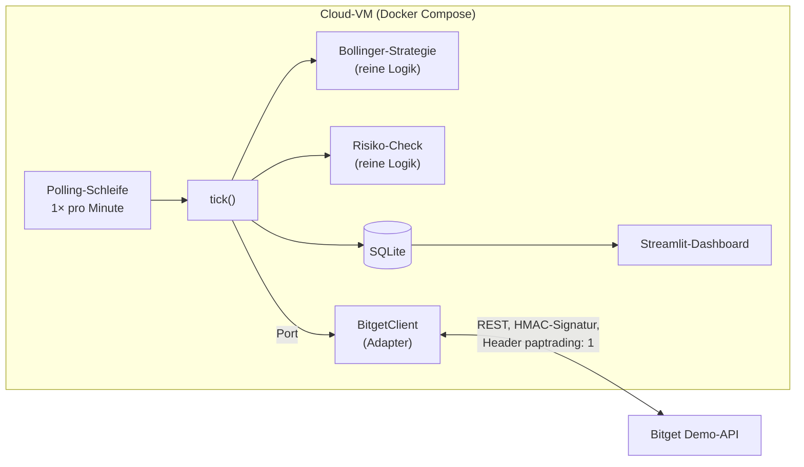
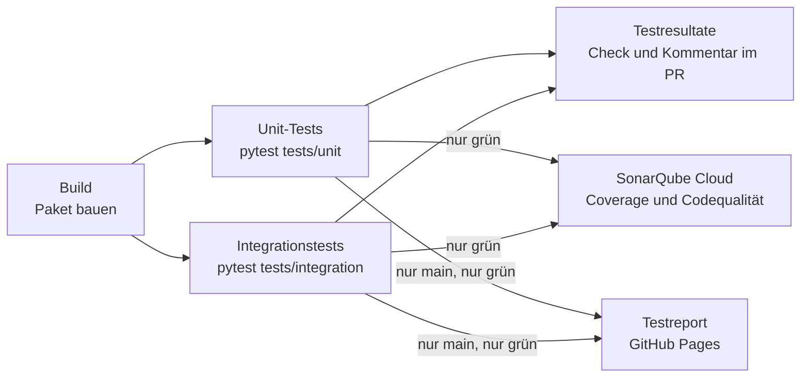

# Bollinger-Bot

[](https://github.com/NicolasHunger/bollinger-bot/actions/workflows/pipeline.yml)
[](https://sonarcloud.io/summary/new_code?id=NicolasHunger_bollinger-bot)
[](https://sonarcloud.io/component_measures?id=NicolasHunger_bollinger-bot&metric=coverage)
[](https://nicolashunger.github.io/bollinger-bot/)

Ein Krypto-Trading-Bot in Python, der mit der Bollinger-Strategie auf dem **Demo-Konto** von
Bitget handelt, also mit Spielgeld. Projektarbeit im Modul 450 «Applikationen testen» an der TBZ.

> [!NOTE]
> Schulprojekt mit Fokus auf Testing. Der Bot handelt ausschliesslich im Demo-Modus von Bitget.
> Nichts hier ist eine Anlageberatung.

- **Team:** Nicolas Hunger, Lucas Weisshaar und Valentin Ernst
- **Modul:** M450 «Applikationen testen», TBZ, Klasse WUP25
- **Abgabe und Präsentation:** Mi 28.10.2026

## Idee

Der Bot läuft rund um die Uhr in einem Container auf einer Cloud-VM:

1. Einmal pro Minute fragt er über die REST-API von Bitget nach, ob eine neue Kerze abgeschlossen ist.
2. Wenn ja, berechnet er die Bollinger-Bänder aus den letzten Schlusskursen.
3. Schliesst eine Kerze unter dem unteren Band, kauft er. Er verkauft, sobald eine Kerze über dem
   Mittelband schliesst (der Kurs ist zur Mitte zurückgekehrt) oder mehr als 3 % unter dem
   Kaufpreis (Stop-Loss, begrenzt den Verlust). Es ist höchstens eine Position gleichzeitig offen.
4. Ein Risiko-Check begrenzt die Positionsgrösse und rundet Menge und Preis auf die Stellen, die
   Bitget erlaubt.
5. Signale, Trades und Kontostand speichert er in SQLite. Ein Streamlit-Dashboard zeigt den Kurs
   mit den Bändern, die Käufe und Verkäufe und den Kontostand.

### Bollinger-Bänder in Kürze

- **Mittelband:** Durchschnitt der letzten n Schlusskurse (Standard: n = 20)
- **Oberes und unteres Band:** Mittelband ± k · σ (Standard: k = 2)
- **σ:** Standardabweichung derselben n Kurse, geteilt durch n (nicht durch n − 1)
- **Idee dahinter (Mean Reversion):** Ein Kurs weit unter dem Durchschnitt kehrt eher zur Mitte
  zurück.

Beispiel mit n = 3, k = 2 und den Kursen 10, 12, 14: Mittelband 12, σ ≈ 1.633, Bänder bei 8.73
und 15.27. Mit σ geteilt durch n − 1 kämen 8.00 und 16.00 heraus, ein typischer Fehler.

### Warum der Bot kaum Geld verdient

Gemessen von Valentin an rund 1000 15-Minuten-Kerzen BTCUSDT (Oktober 2026): Vom unteren Band
bis zum Mittelband sind es im Median nur etwa 0.45 %. Bitget verlangt 0.1 % Gebühr pro Order
(geprüft mit einer Demo-Order), für Kauf und Verkauf also 0.2 %. Ein normaler Trade bringt damit
etwa 0.45 % − 0.2 % ≈ 0.25 %, und ein einziger Stop-Loss von 3 % frisst den Gewinn von über
10 solchen Trades (3 % ÷ 0.25 % = 12). Dazu prüft der Bot den Stop-Loss nur beim Kerzenschluss:
Fällt der Kurs während der Kerze stark, kann der Verlust grösser als 3 % werden. Das bleibt
bewusst so, denn das Projekt soll das Testen zeigen, nicht Gewinn erzielen.

## Architektur



- **`tick()`** enthält einen ganzen Durchgang: Kerzen holen, Signal berechnen, Risiko prüfen,
  eventuell eine Order platzieren, speichern. Die Polling-Schleife ruft nur `tick()` auf.
- **Port:** `tick()` kennt die Börse nur über eine Schnittstelle (`Boerse` in
  `src/bollinger_bot/port.py`: Kerzen holen, Kontostand abfragen, kaufen, verkaufen). In den
  Tests ersetzt ein Mock den echten `BitgetClient`.
- **Strategie und Risiko-Check** sind reine Funktionen ohne I/O und darum einfach zu testen.

## Stack

| Bereich | Werkzeug |
|---|---|
| Sprache | Python |
| Börse | Bitget REST-API im Demo-Modus |
| HTTP | httpx |
| Datenhaltung | SQLite |
| Dashboard | Streamlit |
| Tests | pytest, pytest-mock, respx, pytest-cov, pytest-html |
| CI/CD | GitHub Actions, SonarQube Cloud, GitHub Pages, GitHub Container Registry |
| Betrieb | Docker Compose auf einer Cloud-VM |

## Code-Übersicht

Der Code liegt in `src/bollinger_bot/`, eine Datei pro Baustein. Stand 24.10.2026: Ein Teil liegt
noch in offenen PRs oder Branches (Spalte «Stand»).

| Datei | Was sie macht | Tests | Stand |
|---|---|---|---|
| `bollinger.py` | Berechnet aus den letzten n Schlusskursen das Mittelband (Durchschnitt) und das obere und untere Band (± k · σ, σ geteilt durch n) | `tests/unit/test_bollinger.py` | `main` |
| `regeln.py` | Entscheidet nach jeder Kerze: kaufen (Schluss unter dem unteren Band), verkaufen (über dem Mittelband oder 3 % unter dem Kaufpreis, Stop-Loss) oder halten | `tests/unit/test_regeln.py` | `main` |
| `port.py` | Die Schnittstelle zur Börse (`Boerse` mit vier Methoden) und die Datenklassen `Kerze` und `Order`. `tick()` kennt nur diesen Port, nicht Bitget selbst | `tests/unit/test_port.py` | `main` |
| `risiko.py` | Rechnet den Kaufbetrag in USDT und die Verkaufsmenge in BTC, immer abgerundet auf die Stellen von Bitget, unter 1 USDT keine Order | `tests/unit/test_risiko.py` | PR #8 |
| `speicher.py` | Speichert Signale, Trades und Kontostände in SQLite, prüft die Werte selbst und weiss nach einem Neustart, ob eine Position offen ist | `tests/integration/test_speicher.py` | PR #6 |
| `polling.py` | Erkennt, ob eine neue Kerze fertig ist, und ruft in einer Schleife jede Minute `tick()` auf | `tests/unit/test_polling.py` | PR #7 |
| `bitget_client.py` | Spricht mit Bitget im Demo-Modus: signierte Anfragen, Kerzen, Kontostand, Market-Orders. Erfüllt den Port | `tests/unit/test_signatur.py`, `tests/integration/test_bitget_*.py` | PR #9, #10 |
| `tick.py` | Ein Durchgang des Bots: Kerzen holen, Bänder berechnen, entscheiden, kaufen oder verkaufen, alles speichern | `tests/unit/test_tick.py`, `tests/integration/test_tick.py` | Branch `tick` |
| `start.py`, `__main__.py` | Einstiegspunkt `python -m bollinger_bot`: liest die Umgebungsvariablen und startet Client, Speicher und Polling-Schleife | `tests/unit/test_start.py`, `tests/integration/test_start.py` | Branch `einstiegspunkt` |
| `backtest.py` | Spielt `tick()` mit einer simulierten Börse auf aufgezeichneten Kursen ab und schreibt alles in eine SQLite-Datei (Demo, Testdaten fürs Dashboard) | `tests/unit/test_backtest.py`, `tests/integration/test_backtest.py` | Branch `backtest` |

Dazu zwei Skripte ausserhalb des Pakets, die nie in der Pipeline laufen:

- `scripts/rauchtest.py` (PR #10): Rauchtest von Hand gegen das Bitget-Demo-Konto mit echtem
  Demo-Key.
- `scripts/kerzen_holen.py` (Branch `backtest`): holt die Kerzen für den Backtest vom
  öffentlichen Bitget-Endpunkt.

Zusammenspiel: `tick.py` nutzt `bollinger.py`, `regeln.py`, `risiko.py` und `speicher.py` und
spricht über `port.py` mit der Börse. `start.py` setzt dafür den echten `BitgetClient` ein,
`backtest.py` die simulierte Börse. Das Dashboard (AP 7) liest die SQLite-Datei von
`speicher.py`.

## Entwicklung

Voraussetzung: Python 3.12 oder neuer.

```bash
python3 -m venv .venv            # eigene Python-Umgebung nur für dieses Projekt
source .venv/bin/activate        # Windows: .venv\Scripts\activate
pip install -e ".[dev]"          # Projekt und Test-Werkzeuge installieren
pytest                           # alle Tests ausführen
```

- Der Code liegt in `src/bollinger_bot/`, die Unit-Tests in `tests/unit/`. Die Integrationstests
  kommen nach `tests/integration/`, sobald der erste entsteht.
- Unit- und Integrationstests trennen wir nur über die Ordner: `pytest tests/unit` bzw.
  `pytest tests/integration`.
- Die Abhängigkeiten in der `pyproject.toml` haben Versionsgrenzen: mindestens die Version, mit
  der wir entwickeln, höchstens bis zum nächsten Release, das Bestehendes brechen darf. Das ist
  das nächste Major-Release, bei Paketen unter 1.0 schon die nächste Minor-Version.
- `-e` installiert das Projekt «editierbar»: Änderungen am Code wirken sofort, ohne neu zu
  installieren.

## Teststrategie

_Entwurf, wird im Projekt verfeinert._

| Ebene | Was wird getestet | Werkzeug |
|---|---|---|
| Unit | Bollinger-Berechnung, Kauf- und Verkaufsregeln, Risiko-Check (Rundung und Mindestbetrag, also Grenzwerte), Request-Signatur | pytest |
| Integration | `BitgetClient` gegen gemockte HTTP-Antworten, Speichern in einer echten temporären SQLite-DB, `tick()` von der Kerze bis zur DB, Backtest auf aufgezeichneten Kursen | pytest, respx |
| E2E | Dashboard mit Testdaten | Streamlit `AppTest` oder Playwright |

### Was wird gemockt?

| Schnittstelle | Womit | Warum |
|---|---|---|
| Börse (Port) in den `tick()`-Tests | pytest-mock | Ablauf und Entscheide testen, ohne HTTP |
| Bitget-HTTP in den Client-Tests | respx | Requests und Signatur prüfen, ohne Netzwerk |
| Uhr | Fake-Uhr | «Ist die Kerze fertig?» testen, ohne zu warten |

### Grundsätze

- **Keine echten API-Aufrufe in der Pipeline.** Bitget ist in allen automatischen Tests gemockt.
- **Soll-Werte von Hand nachgerechnet** (Taschenrechner oder Tabellenkalkulation), nicht mit
  derselben Bibliothek erzeugt, die getestet wird.
- **Reports:** JUnit-XML und HTML-Testreport auf GitHub Pages, Coverage in SonarQube Cloud.

## Pipeline

GitHub Actions mit dem Workflow [`pipeline.yml`](.github/workflows/pipeline.yml). Er läuft bei
jedem Pull Request, nach jedem Merge auf `main` und von Hand (Tab «Actions», «Pipeline», «Run
workflow»). Aufgebaut wie in der
[Kursunterlage](https://gitlab.com/ch-tbz-it/Stud/m450/m450/-/blob/main/Unterlagen/projekt/ci-cd.md):
Build, Test, Testresultate veröffentlichen.



| Job | Was er macht | Wann |
|---|---|---|
| Build | baut das Paket (Wheel), installiert und importiert es | immer |
| Unit-Tests, Integrationstests | derselbe Job pro Testordner: `pytest` mit JUnit-XML, `coverage.xml` und HTML-Reports, alles als Artefakt im Pipeline-Lauf | nach dem Build |
| Testresultate veröffentlichen | Check «Testresultate» am Commit, Kommentar mit den Zahlen im PR | auch bei roten Tests |
| SonarQube Cloud | schickt Code, `coverage.xml` und JUnit-XML beider Testordner an SonarQube Cloud. Im PR erscheint der Quality Gate als eigener Check | nur wenn alle Tests grün sind |
| Testreport auf GitHub Pages | Testresultate pro Testordner und die Coverage beider Ordner zusammen (`coverage combine`) als Webseite | nur auf `main`, nur wenn alle Tests grün sind |

- **Testreport:** <https://nicolashunger.github.io/bollinger-bot/>
- **SonarQube Cloud:** <https://sonarcloud.io/project/overview?id=NicolasHunger_bollinger-bot>.
  Einstellungen in [`sonar-project.properties`](sonar-project.properties), der Token liegt als
  GitHub Secret `SONAR_TOKEN` im Repo. «Automatic Analysis» ist in SonarQube Cloud ausgeschaltet:
  Nur die Analyse aus der Pipeline kennt die Coverage, und beide gleichzeitig gehen nicht.
- **Quality Gate:** Standard «Sonar way», unter anderem mindestens 80 % Coverage auf neuem Code
  und keine neuen Sicherheitsprobleme.
- **Coverage gesamt:** Jeder Test-Job misst nur seinen Ordner. Der Client ist zum Beispiel nur
  in den Integrationstests getestet. Aussagekräftig ist darum erst die Coverage beider Ordner
  zusammen, so rechnet auch SonarQube Cloud.
- **Sicherheit:** pip installiert nur fertige Pakete (`--only-binary :all:`), damit beim
  Installieren kein Setup-Skript aus einem Quellpaket läuft. Fremde Actions sind auf einen
  Commit festgelegt statt auf einen Tag, der später auf anderen Code zeigen könnte. Beides hat
  SonarQube Cloud gemeldet. Die zwei Funde «kein Lockfile» sind in `sonar-project.properties`
  mit Begründung ausgenommen.
- **Reports nur in der Pipeline:** Coverage, JUnit-XML und HTML-Reports erzeugt nur der Workflow,
  nicht `addopts` in der `pyproject.toml`. Lokal bleibt `pytest` schnell und ohne Report-Dateien.
- **Coverage mit Zweigen** (`--cov-branch`): Gezählt wird nicht nur, welche Zeilen laufen, sondern
  auch, ob bei jedem `if` beide Wege getestet sind (Zweigabdeckung).
- **Folgt:** Docker-Image in die GitHub Container Registry und Deploy auf die Cloud-VM (AP 8b),
  beide nur bei grünen Tests.

Dieselben Reports lokal (landen in `reports/` und `htmlcov/`, beide stehen in der `.gitignore`):

```bash
pytest tests/unit --html=reports/unit.html --self-contained-html --cov=bollinger_bot --cov-branch --cov-report=html
```

## Geheimnisse

- Die Bitget-Demo-Keys liegen nur auf der VM, als Umgebungsvariablen in einer `.env`-Datei, die
  per `.gitignore` ausgeschlossen ist.
- Die Pipeline braucht keine Bitget-Keys, nur das Sonar-Token (`SONAR_TOKEN`) und später einen
  SSH-Schlüssel für das Deployment, beide als GitHub Secrets.

## Planung

_Entwurf, wird im Projekt verfeinert._

| Wann | Ziel |
|---|---|
| bis Mi 30.09. | Grundgerüst, Pipeline mit Build und Test, SonarQube Cloud angebunden, erste Bausteine |
| Mi 30.09. (Unterricht CI/CD und Deployment) | Deploy-Stage auf die Cloud-VM |
| Herbstferien | Bitget-Client, Risiko-Check, `tick()` mit Polling, SQLite, Dashboard. Der Bot läuft spätestens Mitte Ferien auf der VM. |
| Mi 21.10. (Unterricht Code Reviews) | Offene PRs abschliessen, Reflexion schreiben |
| Mi 28.10. | Doku fertig, Präsentation (10 Minuten) |

### Arbeitspakete

Jedes Paket bekommt einen eigenen Branch und Pull Request. Ziel: mindestens 3 aktiv diskutierte
PRs pro Person.

| # | Paket | Wer | Review |
|---|---|---|---|
| 1 | Bollinger-Berechnung | Lucas | Valentin |
| 2 | Kauf- und Verkaufsregeln | Lucas | Valentin |
| 3 | Bitget-Client: Signatur und Kerzen | Valentin | Lucas |
| 4 | Bitget-Client: Orders und Kontostand | Valentin | Lucas |
| 5 | Risiko-Check | Valentin | Lucas |
| 6 | `tick()`, Polling-Schleife und SQLite | Lucas | Nicolas |
| 7 | Dashboard | Nicolas | Valentin |
| 8a.1 | Grundgerüst (Projektstruktur, `pyproject.toml`, pytest läuft lokal) | Lucas | Valentin |
| 8a.2 | Pipeline (Build, Test, SonarQube Cloud) | Nicolas | Valentin |
| 8b | Deploy auf die VM | Nicolas | Valentin |

- **Reviews im Ring, entlang der Abhängigkeiten:** Lucas reviewt Valentin (`tick()` benutzt den
  Client), Nicolas reviewt Lucas (das Dashboard liest die SQLite-Tabellen), Valentin reviewt
  Nicolas. Ausnahme: Die ersten PRs von Lucas (8a.1, 1 und 2) reviewt Valentin, weil Nicolas
  zum Projektstart ausfällt.
- **Zuerst 8a.1:** Das Grundgerüst muss gemergt sein, bevor die anderen Pakete starten. Bis die
  Pipeline (8a.2) steht, lassen wir `pytest` vor jedem Merge lokal laufen.
- **Gemeinsam festlegen:** die Port-Schnittstelle zwischen `tick()` und dem Client sowie das
  SQLite-Schema zwischen `tick()` und dem Dashboard.
- **Doku:** Testkonzept Valentin, Planung und Architektur nachführen Nicolas, die Reflexion
  schreibt jede Person für ihren Teil.

### Offene Entscheide

- Spot oder USDT-M-Futures? Im Demo-Modus von Bitget prüfen, ob Spot angeboten wird. Sonst
  Futures mit Hebel 1 und nur Long-Positionen.
- Handelspaar (z.B. BTCUSDT) und Kerzen-Intervall (z.B. 15 Minuten)
- Anbieter der Cloud-VM (z.B. Hetzner oder Infomaniak)
- **Entschieden: Reports nur in der Pipeline** (21.10.2026). Coverage, JUnit-XML und HTML-Report
  erzeugt der Workflow, `addopts` in der `pyproject.toml` bleibt ohne Report-Optionen.

## Testkonzept

_Folgt, klein gehalten nach der
[Vorlage aus den Kursunterlagen](https://gitlab.com/ch-tbz-it/Stud/m450/m450/-/blob/main/Unterlagen/testkonzept/README.md)._

## Reflexion

Reflexion über Code Reviews und TDD, jede Person für ihren Teil (gemäss Eckdaten und
[Auswertung im Projekt](https://gitlab.com/ch-tbz-it/Stud/m450/m450/-/blob/main/Unterlagen/projekt/auswertungen.md)).
Leitfragen: Wie haben wir Code Reviews und TDD im Projekt erlebt? Was hat gut funktioniert und
taugt für den Berufsalltag? Was lief weniger gut, was würden wir anders machen? Was nehmen wir mit?

### Lucas

**Code Reviews.** Inhaltlich haben die Reviews viel gebracht. Valentin hat gezeigt, dass eine
Versionsgrenze wie `<1` bei Paketen unter 1.0 nichts schützt, und dass Bitget beim Market-Kauf
einen Betrag in USDT erwartet und keine Menge in BTC. Ohne diesen Hinweis hätte der Bot nie
korrekt gekauft. Nicolas hat in PR #6 durchgesetzt, dass die Datenbank ungültige Werte selbst
ablehnt. In meinem Review von PR #10 wurde sichtbar, dass eine Order nach einem einzigen
Netzfehler verloren gehen kann. Es ist gut, dass wir uns gegenseitig überprüft haben, so wusste
jeder, was der andere ungefähr macht. Für den Berufsalltag nehme ich mit: kleinere PRs, die man in
kurzer Zeit reviewen kann, feste Zeiten fürs Reviewen und ein Schutz auf `main`, damit niemand
ohne Approve mergen kann.

**TDD.** Bei `tick()`, dem Herzstück des Bots, haben wir TDD verwendet. Für jedes Verhalten kam
zuerst ein Test, der rot war, zum Beispiel «ohne neue Kerze wird Bitget nicht gefragt» oder «nach
einem Absturz wird nicht doppelt gekauft». Danach nur so viel Code, bis er grün war, und wo nötig
ein Schritt zum Aufräumen. In der Git-Historie des Branches `tick` sieht man das an 41 Commits,
davon 16 mit «TDD rot». Nach demselben Muster sind danach auch der Einstiegspunkt und der Backtest
entstanden.

**Fazit.** Schlussendlich war es ein tolles Projekt, an dem wir hier gearbeitet haben. Das Einzige,
was man vielleicht «negativ» bemängeln kann, ist, dass das Projekt ein bisschen zu gross oder zu
umfangreich geworden ist. Aber auch hier muss ich sagen, dass es eigentlich sehr viel Spass
gemacht hat, die Komponenten einzeln zu bauen und zu schauen, ob sie miteinander funktionieren.

### Valentin

_Folgt._

### Nicolas

_Folgt._

## KI-Nutzung

Gemäss Projektvorgaben deklarieren wir, ob und wie wir KI einsetzen. Die Liste wird laufend
nachgeführt.

- **Als Nachschlagewerk:** Claude Code (Anthropic) für die Projektfindung per Interview, für
  Recherchen (Bitget-Demo-API, Test-Werkzeuge für COBOL) und zur Erklärung der Bollinger-Bänder.
- **Für die Dokumentation:** Den ersten Entwurf dieses READMEs hat Claude Code aus unserem
  Interview erstellt.
- **Zum Schreiben von Code:** _noch offen_
- **Zum automatischen Erstellen von Code durch einen Agenten:** Den Code und die Tests von Lucas
  (Grundgerüst, Bollinger-Berechnung, Kauf- und Verkaufsregeln, Port-Schnittstelle,
  SQLite-Speicher, Polling-Schleife; PR #1 bis #7) hat Claude Code geschrieben, ebenso die
  Änderungen nach den Reviews und die Entwürfe der Antworten auf die Reviews. Lucas hat die
  Vorgaben gemacht, die Entscheide getroffen und die Antworten freigegeben. Die Soll-Werte in den
  Tests sind von Hand hergeleitet (Rechnung als Kommentar im Test). Die Werte der
  Bollinger-Berechnung hat Valentin im Review nachgerechnet. Den Workflow der Pipeline
  (`.github/workflows/pipeline.yml`) und die Anbindung an SonarQube Cloud hat Claude Code mit
  Nicolas geschrieben und Schritt für Schritt erklärt, ebenso die Entwürfe der Antworten auf die
  Reviews von PR #12. Die Entscheide zu den Reports, zu pytest-html und zu den Funden von
  SonarQube Cloud hat Nicolas getroffen, GitHub Pages und SonarQube Cloud hat er selbst
  eingerichtet.
- **Zum Reviewen oder Optimieren:** Die Reviews von PR #6 und PR #7 hat Nicolas mit Claude Code
  vorbereitet: Claude Code hat die PRs lokal getestet, Randfälle nachgeprüft und die Kommentare
  formuliert. Die inhaltlichen Entscheide (z.B. Kerzen im Dashboard, Kontostand als Gesamtwert,
  `stop_signal: SIGINT`) und den Review-Status hat Nicolas getroffen, gepostet wurde erst nach
  Durchsicht.

## Kursunterlagen

- [Projekt: Rahmenbedingungen und Bewertungsrubrik](https://gitlab.com/ch-tbz-it/Stud/m450/m450/-/blob/main/Unterlagen/projekt/README.md)
- [Eckdaten](https://gitlab.com/ch-tbz-it/Stud/m450/m450/-/blob/main/Unterlagen/projekt/grundaufbau.md)
- [CI/CD im Projekt](https://gitlab.com/ch-tbz-it/Stud/m450/m450/-/blob/main/Unterlagen/projekt/ci-cd.md)
- [Code Reviews im Projekt](https://gitlab.com/ch-tbz-it/Stud/m450/m450/-/blob/main/Unterlagen/projekt/code-reviews.md)
