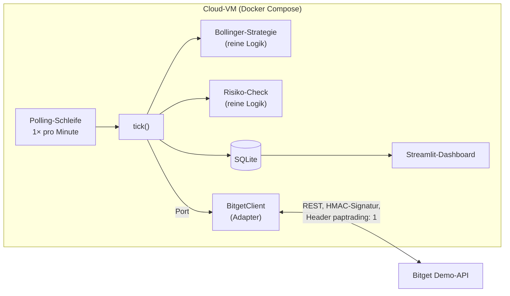

# Bollinger-Bot

Ein Krypto-Trading-Bot in Python, der mit der Bollinger-Strategie auf dem **Demo-Konto** von
Bitget handelt, also mit Spielgeld. Projektarbeit im Modul 450 «Applikationen testen» an der TBZ.

> [!NOTE]
> Schulprojekt mit Fokus auf Testing. Der Bot handelt ausschliesslich im Demo-Modus von Bitget.
> Nichts hier ist eine Anlageberatung.

- **Team:** Nicolas Hunger, Lucas Weisshaar und Valentin Ernst
- **Modul:** M450 «Applikationen testen», TBZ, Klasse WUP25
- **Abgabe und Präsentation:** Mi 28.10.2026

## Idee

Der Bot läuft rund um die Uhr in einem Container auf einer Cloud-VM:

1. Einmal pro Minute fragt er über die REST-API von Bitget nach, ob eine neue Kerze abgeschlossen ist.
2. Wenn ja, berechnet er die Bollinger-Bänder aus den letzten Schlusskursen.
3. Schliesst eine Kerze unter dem unteren Band, kauft er. Wann er verkauft (oberes Band oder
   Mittelband), legen wir noch fest.
4. Ein Risiko-Check begrenzt die Positionsgrösse und rundet Menge und Preis auf die Stellen, die
   Bitget erlaubt.
5. Signale, Trades und Kontostand speichert er in SQLite. Ein Streamlit-Dashboard zeigt den Kurs
   mit den Bändern, die Käufe und Verkäufe und den Kontostand.

### Bollinger-Bänder in Kürze

- **Mittelband:** Durchschnitt der letzten n Schlusskurse (Standard: n = 20)
- **Oberes und unteres Band:** Mittelband ± k · σ (Standard: k = 2)
- **σ:** Standardabweichung derselben n Kurse, geteilt durch n (nicht durch n − 1)
- **Idee dahinter (Mean Reversion):** Ein Kurs weit unter dem Durchschnitt kehrt eher zur Mitte
  zurück.

Beispiel mit n = 3, k = 2 und den Kursen 10, 12, 14: Mittelband 12, σ ≈ 1.633, Bänder bei 8.73
und 15.27. Mit σ geteilt durch n − 1 kämen 8.00 und 16.00 heraus, ein typischer Fehler.

## Architektur



- **`tick()`** enthält einen ganzen Durchgang: Kerzen holen, Signal berechnen, Risiko prüfen,
  eventuell eine Order platzieren, speichern. Die Polling-Schleife ruft nur `tick()` auf.
- **Port:** `tick()` kennt die Börse nur über eine Schnittstelle. In den Tests ersetzt ein Mock
  den echten `BitgetClient`.
- **Strategie und Risiko-Check** sind reine Funktionen ohne I/O und darum einfach zu testen.

## Stack

| Bereich | Werkzeug |
|---|---|
| Sprache | Python |
| Börse | Bitget REST-API im Demo-Modus |
| HTTP | httpx |
| Datenhaltung | SQLite |
| Dashboard | Streamlit |
| Tests | pytest, pytest-mock, respx, pytest-cov |
| CI/CD | GitHub Actions, SonarQube Cloud, GitHub Pages, GitHub Container Registry |
| Betrieb | Docker Compose auf einer Cloud-VM |

## Entwicklung

Voraussetzung: Python 3.12 oder neuer.

```bash
python3 -m venv .venv            # eigene Python-Umgebung nur für dieses Projekt
source .venv/bin/activate        # Windows: .venv\Scripts\activate
pip install -e ".[dev]"          # Projekt und Test-Werkzeuge installieren
pytest                           # alle Tests ausführen
```

- Der Code liegt in `src/bollinger_bot/`, die Unit-Tests in `tests/unit/`. Die Integrationstests
  kommen nach `tests/integration/`, sobald der erste entsteht.
- `-e` installiert das Projekt «editierbar»: Änderungen am Code wirken sofort, ohne neu zu
  installieren.

## Teststrategie

_Entwurf, wird im Projekt verfeinert._

| Ebene | Was wird getestet | Werkzeug |
|---|---|---|
| Unit | Bollinger-Berechnung, Kauf- und Verkaufsregeln, Risiko-Check (Rundung und Mindestbetrag, also Grenzwerte), Request-Signatur | pytest |
| Integration | `BitgetClient` gegen gemockte HTTP-Antworten, Speichern in einer echten temporären SQLite-DB, `tick()` von der Kerze bis zur DB, Backtest auf aufgezeichneten Kursen | pytest, respx |
| E2E | Dashboard mit Testdaten | Streamlit `AppTest` oder Playwright |

### Was wird gemockt?

| Schnittstelle | Womit | Warum |
|---|---|---|
| Börse (Port) in den `tick()`-Tests | pytest-mock | Ablauf und Entscheide testen, ohne HTTP |
| Bitget-HTTP in den Client-Tests | respx | Requests und Signatur prüfen, ohne Netzwerk |
| Uhr | Fake-Uhr | «Ist die Kerze fertig?» testen, ohne zu warten |

### Grundsätze

- **Keine echten API-Aufrufe in der Pipeline.** Bitget ist in allen automatischen Tests gemockt.
- **Soll-Werte von Hand nachgerechnet** (Taschenrechner oder Tabellenkalkulation), nicht mit
  derselben Bibliothek erzeugt, die getestet wird.
- **Reports:** JUnit-XML und HTML-Testreport auf GitHub Pages, Coverage in SonarQube Cloud.

## Pipeline

```text
Build ──► Test ──► Deploy (nur auf main, nur wenn alle Tests grün sind)
           │        ├─ Testreport   → GitHub Pages
           │        ├─ Docker-Image → GitHub Container Registry
           │        └─ Cloud-VM     → docker compose pull && docker compose up -d
           └─ JUnit-XML → Testresultate im PR, coverage.xml → SonarQube Cloud
```

## Geheimnisse

- Die Bitget-Demo-Keys liegen nur auf der VM, als Umgebungsvariablen in einer `.env`-Datei, die
  per `.gitignore` ausgeschlossen ist.
- Die Pipeline braucht keine Bitget-Keys, nur ein Sonar-Token und einen SSH-Schlüssel für das
  Deployment, beide als GitHub Secrets.

## Planung

_Entwurf, wird im Projekt verfeinert._

| Wann | Ziel |
|---|---|
| bis Mi 30.09. | Grundgerüst, Pipeline mit Build und Test, SonarQube Cloud angebunden, erste Bausteine |
| Mi 30.09. (Unterricht CI/CD und Deployment) | Deploy-Stage auf die Cloud-VM |
| Herbstferien | Bitget-Client, Risiko-Check, `tick()` mit Polling, SQLite, Dashboard. Der Bot läuft spätestens Mitte Ferien auf der VM. |
| Mi 21.10. (Unterricht Code Reviews) | Offene PRs abschliessen, Reflexion schreiben |
| Mi 28.10. | Doku fertig, Präsentation (10 Minuten) |

### Arbeitspakete

Jedes Paket bekommt einen eigenen Branch und Pull Request. Ziel: mindestens 3 aktiv diskutierte
PRs pro Person.

| # | Paket | Wer | Review |
|---|---|---|---|
| 1 | Bollinger-Berechnung | Lucas | Valentin |
| 2 | Kauf- und Verkaufsregeln | Lucas | Valentin |
| 3 | Bitget-Client: Signatur und Kerzen | Valentin | Lucas |
| 4 | Bitget-Client: Orders und Kontostand | Valentin | Lucas |
| 5 | Risiko-Check | Valentin | Lucas |
| 6 | `tick()`, Polling-Schleife und SQLite | Lucas | Nicolas |
| 7 | Dashboard | Nicolas | Valentin |
| 8a.1 | Grundgerüst (Projektstruktur, `pyproject.toml`, pytest läuft lokal) | Lucas | Valentin |
| 8a.2 | Pipeline (Build, Test, SonarQube Cloud) | Nicolas | Valentin |
| 8b | Deploy auf die VM | Nicolas | Valentin |

- **Reviews im Ring, entlang der Abhängigkeiten:** Lucas reviewt Valentin (`tick()` benutzt den
  Client), Nicolas reviewt Lucas (das Dashboard liest die SQLite-Tabellen), Valentin reviewt
  Nicolas. Ausnahme: Die ersten PRs von Lucas (8a.1, 1 und 2) reviewt Valentin, weil Nicolas
  zum Projektstart ausfällt.
- **Zuerst 8a.1:** Das Grundgerüst muss gemergt sein, bevor die anderen Pakete starten. Bis die
  Pipeline (8a.2) steht, lassen wir `pytest` vor jedem Merge lokal laufen.
- **Gemeinsam festlegen:** die Port-Schnittstelle zwischen `tick()` und dem Client sowie das
  SQLite-Schema zwischen `tick()` und dem Dashboard.
- **Doku:** Testkonzept Valentin, Planung und Architektur nachführen Nicolas, die Reflexion
  schreibt jede Person für ihren Teil.

### Offene Entscheide

- Spot oder USDT-M-Futures? Im Demo-Modus von Bitget prüfen, ob Spot angeboten wird. Sonst
  Futures mit Hebel 1 und nur Long-Positionen.
- Handelspaar (z.B. BTCUSDT) und Kerzen-Intervall (z.B. 15 Minuten)
- Verkaufsregel (oberes Band oder Mittelband) und Stop-Loss
- Anbieter der Cloud-VM (z.B. Hetzner oder Infomaniak)

## Testkonzept

Klein gehalten nach der
[Vorlage aus den Kursunterlagen](https://gitlab.com/ch-tbz-it/Stud/m450/m450/-/blob/main/Unterlagen/testkonzept/README.md)
(IEEE 829). Welche Ebene womit getestet wird, steht oben unter [Teststrategie](#teststrategie).

### Testobjekte

Die Bausteine aus der [Architektur](#architektur), je eine Datei in `src/bollinger_bot/`:

| Baustein | Datei | Art | Tests |
|---|---|---|---|
| Bollinger-Berechnung | `bollinger.py` | reine Funktion | Unit |
| Kauf- und Verkaufsregeln | `regeln.py` | reine Funktion | Unit |
| Risiko-Check | `risiko.py` | reine Funktion | Unit |
| Port zur Börse | `port.py` | Schnittstelle (`Protocol`) | Unit (Mock nach Vorbild des Ports) |
| Bitget-Client | `bitget_client.py` | Adapter zu Bitget | Unit (Signatur), Integration (respx) |
| SQLite-Speicher | `speicher.py` | Adapter zur Datenbank | Integration (echte temporäre Datei) |
| Polling | `polling.py` | Zeitlogik und Schleife | Unit (Fake-Uhr) |
| `tick()` | folgt | setzt alles zusammen | Integration (Port gemockt, echte DB) |
| Dashboard | folgt | Streamlit | E2E (`AppTest` mit Testdaten) |

### Zu testende Funktionen

- **Rechnen:** Bänder mit σ geteilt durch n, Kaufbetrag und Verkaufsmenge abgerundet auf die
  Stellen von Bitget, Mindestbetrag von 1 USDT
- **Entscheiden:** Kauf unter dem unteren Band, Verkauf über dem Mittelband oder beim Stop-Loss,
  höchstens eine offene Position
- **Mit Bitget sprechen:** Signatur, Header `paptrading: 1`, nur abgeschlossene Kerzen, Market-Orders
  mit Menge ohne Gebühr, Fehler von Bitget und Netzwerkfehler als `BitgetFehler`
- **Speichern:** Signale, Trades und Kontostände, jede Kerze nur einmal, offene Position nach
  einem Neustart, Zeiten immer in UTC
- **Ablauf:** eine neue Kerze wird genau einmal ausgewertet, ein Fehler in `tick()` beendet den
  Bot nicht

### Nicht getestet

- **Echte Bitget-API in der Pipeline.** Die Pipeline hat keine API-Keys. Ob Bitget die Anfragen
  wirklich annimmt, prüfen wir einmal von Hand (siehe unten, Testaufgaben).
- **Gewinn der Strategie.** Ziel ist, dass der Bot die Regeln korrekt umsetzt, nicht, dass er
  Geld verdient.
- **Performance und Last.** Der Bot macht eine Anfrage pro Minute.
- **Docker-Image und VM.** Der Deploy wird nur dadurch geprüft, dass der Container startet.

### Vorgehen

- **Grenzwerte:** Jede Grenze wird genau auf der Grenze und knapp daneben getestet, z.B. Kurs
  genau auf dem Band, Kaufbetrag genau 1.00 USDT und 0.99 USDT, Kerze genau beim Schluss und
  1 ms davor.
- **Soll-Werte unabhängig berechnet:** von Hand (Rechnung als Kommentar im Test) oder mit einem
  anderen Werkzeug, z.B. die Signaturen mit `openssl`.
- **Abhängigkeiten ersetzt:** Bitget mit respx (HTTP) oder einem Autospec-Mock des Ports, die
  Uhr mit einer Fake-Uhr, das Warten mit einer Fake-Funktion. Die Datenbank ist echt, aber eine
  temporäre Datei pro Test.
- **Testdaten nah an der Wirklichkeit:** Die Bitget-Antworten in den Tests haben die Form echter
  Antworten der Demo-API.

### Bestanden, wenn

- alle Tests grün sind. Ein roter Test verhindert den Merge und den Deploy.
- die Coverage den Quality Gate von SonarQube Cloud erfüllt (Standard: 80 % auf neuem Code).
- der Reviewer im PR die Soll-Werte mindestens eines Tests selbst nachgerechnet hat.

Gefundene Fehler halten wir im PR als Kommentar fest. Schwere Fehler (falsche Order, falscher
Betrag, Absturz) blockieren den Merge, leichte (Text, Logmeldung) dürfen in einem Folge-PR kommen.

### Ergebnisse

- **JUnit-XML** aus pytest: Testresultate im PR und in GitHub Actions
- **HTML-Testreport** auf GitHub Pages
- **`coverage.xml`** aus pytest-cov für SonarQube Cloud

### Testaufgaben

| Ebene | Befehl | Wann |
|---|---|---|
| Unit | `pytest tests/unit` | lokal vor jedem Push, in der Pipeline bei jedem PR |
| Integration | `pytest tests/integration` | lokal vor jedem Push, in der Pipeline bei jedem PR |
| E2E Dashboard | folgt mit #7 | in der Pipeline bei jedem PR |
| Rauchtest Bitget | von Hand mit Demo-Key: Kerzen holen, Kontostand, ein Kauf und ein Verkauf für 5 USDT | einmal vor dem ersten Deploy |

Der Rauchtest prüft, was die Mocks nicht prüfen können: ob Bitget die Signatur annimmt, ob das
Demo-Konto die Classic-Endpunkte `/api/v2/spot/…` verwendet und wie die Gebühr in `feeDetail`
wirklich aussieht.

### Testumgebung

- Python 3.12, Installation mit `pip install -e ".[dev]"` (siehe [Entwicklung](#entwicklung))
- lokal: Windows und macOS, in der Pipeline: Ubuntu auf GitHub Actions
- kein Netzwerk nötig, keine API-Keys, keine echte Datenbank ausser temporären Dateien

### Zeitplan und Verantwortung

- Wer einen Baustein schreibt, schreibt seine Tests im selben PR (siehe
  [Arbeitspakete](#arbeitspakete)). Kein TDD, die Tests entstehen mit dem Code.
- Wer reviewt, führt die Tests lokal aus und rechnet mindestens einen Soll-Wert nach.
- Bis Mi 21.10.: Unit- und Integrationstests aller Bausteine ausser `tick()` und Dashboard.
  Bis Mi 28.10.: `tick()`, Dashboard, Rauchtest, Reports in der Pipeline.

## Reflexion

_Folgt am Projektende (gemäss Eckdaten: Code Reviews und TDD)._

## KI-Nutzung

Gemäss Projektvorgaben deklarieren wir, ob und wie wir KI einsetzen. Die Liste wird laufend
nachgeführt.

- **Als Nachschlagewerk:** Claude Code (Anthropic) für die Projektfindung per Interview, für
  Recherchen (Bitget-Demo-API, Test-Werkzeuge für COBOL) und zur Erklärung der Bollinger-Bänder.
- **Für die Dokumentation:** Den ersten Entwurf dieses READMEs hat Claude Code aus unserem
  Interview erstellt. Den Entwurf des Testkonzepts hat Claude Code nach der Vorlage aus den
  Kursunterlagen geschrieben.
- **Zum Schreiben von Code:** _noch offen_
- **Zum automatischen Erstellen von Code durch einen Agenten:** Das Grundgerüst (`pyproject.toml`,
  Ordnerstruktur, erster Test) hat Claude Code angelegt.
- **Zum Reviewen oder Optimieren:** _noch offen_

## Kursunterlagen

- [Projekt: Rahmenbedingungen und Bewertungsrubrik](https://gitlab.com/ch-tbz-it/Stud/m450/m450/-/blob/main/Unterlagen/projekt/README.md)
- [Eckdaten](https://gitlab.com/ch-tbz-it/Stud/m450/m450/-/blob/main/Unterlagen/projekt/grundaufbau.md)
- [CI/CD im Projekt](https://gitlab.com/ch-tbz-it/Stud/m450/m450/-/blob/main/Unterlagen/projekt/ci-cd.md)
- [Code Reviews im Projekt](https://gitlab.com/ch-tbz-it/Stud/m450/m450/-/blob/main/Unterlagen/projekt/code-reviews.md)
