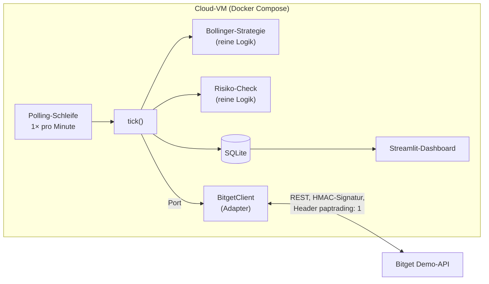
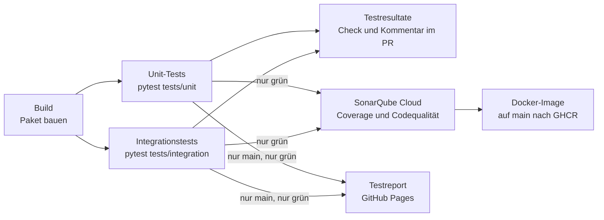

# Bollinger-Bot

[](https://github.com/NicolasHunger/bollinger-bot/actions/workflows/pipeline.yml)
[](https://sonarcloud.io/summary/new_code?id=NicolasHunger_bollinger-bot)
[](https://sonarcloud.io/component_measures?id=NicolasHunger_bollinger-bot&metric=coverage)
[](https://nicolashunger.github.io/bollinger-bot/)

Ein Krypto-Trading-Bot in Python, der mit der Bollinger-Strategie auf dem **Demo-Konto** von
Bitget handelt, also mit Spielgeld. Projektarbeit im Modul 450 «Applikationen testen» an der TBZ.

> [!NOTE]
> Schulprojekt mit Fokus auf Testing. Der Bot handelt ausschliesslich im Demo-Modus von Bitget.
> Nichts hier ist eine Anlageberatung.

- **Team:** Nicolas Hunger, Lucas Weisshaar und Valentin Ernst
- **Modul:** M450 «Applikationen testen», TBZ, Klasse WUP25
- **Abgabe und Präsentation:** Mi 28.10.2026

## Idee

Der Bot läuft rund um die Uhr in einem Container auf einer Cloud-VM:

1. Einmal pro Minute fragt er über die REST-API von Bitget nach, ob eine neue Kerze abgeschlossen ist.
2. Wenn ja, berechnet er die Bollinger-Bänder aus den letzten Schlusskursen.
3. Schliesst eine Kerze unter dem unteren Band, kauft er. Er verkauft, sobald eine Kerze über dem
   Mittelband schliesst (der Kurs ist zur Mitte zurückgekehrt) oder mehr als 3 % unter dem
   Kaufpreis (Stop-Loss, begrenzt den Verlust). Es ist höchstens eine Position gleichzeitig offen.
4. Ein Risiko-Check begrenzt die Positionsgrösse und rundet Menge und Preis auf die Stellen, die
   Bitget erlaubt.
5. Signale, Trades und Kontostand speichert er in SQLite. Ein Streamlit-Dashboard zeigt den Kurs
   mit den Bändern, die Käufe und Verkäufe und den Kontostand.

### Bollinger-Bänder in Kürze

- **Mittelband:** Durchschnitt der letzten n Schlusskurse (Standard: n = 20)
- **Oberes und unteres Band:** Mittelband ± k · σ (Standard: k = 2)
- **σ:** Standardabweichung derselben n Kurse, geteilt durch n (nicht durch n − 1)
- **Idee dahinter (Mean Reversion):** Ein Kurs weit unter dem Durchschnitt kehrt eher zur Mitte
  zurück.

Beispiel mit n = 3, k = 2 und den Kursen 10, 12, 14: Mittelband 12, σ ≈ 1.633, Bänder bei 8.73
und 15.27. Mit σ geteilt durch n − 1 kämen 8.00 und 16.00 heraus, ein typischer Fehler.

### Warum der Bot kaum Geld verdient

Gemessen von Valentin an rund 1000 15-Minuten-Kerzen BTCUSDT (Oktober 2026): Vom unteren Band
bis zum Mittelband sind es im Median nur etwa 0.45 %. Bitget verlangt 0.1 % Gebühr pro Order
(geprüft mit einer Demo-Order), für Kauf und Verkauf also 0.2 %. Ein normaler Trade bringt damit
etwa 0.45 % − 0.2 % ≈ 0.25 %, und ein einziger Stop-Loss von 3 % frisst den Gewinn von über
10 solchen Trades (3 % ÷ 0.25 % = 12). Dazu prüft der Bot den Stop-Loss nur beim Kerzenschluss:
Fällt der Kurs während der Kerze stark, kann der Verlust grösser als 3 % werden. Das bleibt
bewusst so, denn das Projekt soll das Testen zeigen, nicht Gewinn erzielen.

## Architektur



- **`tick()`** enthält einen ganzen Durchgang: Kerzen holen, Signal berechnen, Risiko prüfen,
  eventuell eine Order platzieren, speichern. Die Polling-Schleife ruft nur `tick()` auf.
- **Port:** `tick()` kennt die Börse nur über eine Schnittstelle (`Boerse` in
  `src/bollinger_bot/port.py`: Kerzen holen, Kontostand abfragen, kaufen, verkaufen). In den
  Tests ersetzt ein Mock den echten `BitgetClient`.
- **Strategie und Risiko-Check** sind reine Funktionen ohne I/O und darum einfach zu testen.

### Datenbank

`tick()` schreibt über `src/bollinger_bot/speicher.py` in eine SQLite-Datei, das Dashboard liest
daraus. Alle Zeitpunkte stehen als Text im Format ISO 8601 in UTC in der Datenbank, auf
Mikrosekunden genau (z.B. `2026-10-17T12:00:00.000000+00:00`).

| Tabelle | Inhalt | Wofür |
|---|---|---|
| `signale` | pro abgeschlossener Kerze: Startzeit, Eröffnung, Hoch, Tief, Schlusskurs, drei Bänder, Signal (`kaufen`, `verkaufen`, `halten`) | Kurs als Kerzen mit Bändern im Dashboard, «Kerze schon ausgewertet?» |
| `trades` | Zeit, Seite (`kauf`, `verkauf`), Menge, Preis, Order-ID | Käufe und Verkäufe im Dashboard, offene Position nach einem Neustart |
| `kontostaende` | Zeit, Währung, Betrag (frei verfügbares Guthaben) | Verlauf des Kontostands im Dashboard |

- **Eine Datei gilt für genau ein Handelspaar und ein Kerzen-Intervall.** Keine Tabelle hält
  fest, zu welchem Paar und Intervall die Daten gehören. Wer wechselt (z.B. für die Präsentation
  auf ein kürzeres Intervall), setzt einen neuen `BOT_DB_PFAD`. Sonst mischen sich alte und neue
  Kerzen im Chart, und `offene_position()` liefert womöglich einen Kauf des alten Paars.
- **`betrag`** ist das frei verfügbare Guthaben (z.B. USDT), so wie es `hole_kontostand` liefert.
  `tick()` speichert nach jeder ausgewerteten Kerze eine Zeile mit den freien USDT. Bei einem Kauf
  sinkt dieser Betrag, ohne dass Geld verloren geht. Den Gesamtwert (freie USDT + offene Menge ×
  Schlusskurs) rechnet darum das Dashboard selbst aus.
- **Die Datenbank prüft selbst** und wirft bei einem Verstoss `sqlite3.IntegrityError`: Kurse,
  Mengen und Preise grösser als 0, Kontostand nicht negativ, Eröffnung und Schlusskurs zwischen
  Tief und Hoch, unteres Band ≤ Mittelband ≤ oberes Band (die Bänder selbst dürfen negativ sein),
  gültiges Signal und gültige Seite, jede Order-ID nur einmal. Eine schon gespeicherte Kerze ist
  kein Fehler, `speichere_signal()` gibt dann `False` zurück.
- **Python prüft vor dem Schreiben** und wirft einen `ValueError`: Zeit ohne Zeitzone, Kauf bei
  offener Position, Verkauf ohne offene Position. Es ist also höchstens eine Position offen.

## Stack

| Bereich | Werkzeug |
|---|---|
| Sprache | Python |
| Börse | Bitget REST-API im Demo-Modus |
| HTTP | httpx |
| Datenhaltung | SQLite |
| Dashboard | Streamlit |
| Tests | pytest, pytest-mock, respx, pytest-cov, pytest-html |
| CI/CD | GitHub Actions, SonarQube Cloud, GitHub Pages, GitHub Container Registry |
| Betrieb | Docker Compose auf einer Cloud-VM |

## Code-Übersicht

Der Code liegt in `src/bollinger_bot/`, eine Datei pro Baustein. Stand 27.10.2026: Ein Teil liegt
noch in offenen PRs oder Branches (Spalte «Stand»).

| Datei | Was sie macht | Tests | Stand |
|---|---|---|---|
| `bollinger.py` | Berechnet aus den letzten n Schlusskursen das Mittelband (Durchschnitt) und das obere und untere Band (± k · σ, σ geteilt durch n) | `tests/unit/test_bollinger.py` | `main` |
| `regeln.py` | Entscheidet nach jeder Kerze: kaufen (Schluss unter dem unteren Band), verkaufen (über dem Mittelband oder 3 % unter dem Kaufpreis, Stop-Loss) oder halten | `tests/unit/test_regeln.py` | `main` |
| `port.py` | Die Schnittstelle zur Börse (`Boerse` mit vier Methoden) und die Datenklassen `Kerze` und `Order`. `tick()` kennt nur diesen Port, nicht Bitget selbst | `tests/unit/test_port.py` | `main` |
| `risiko.py` | Rechnet den Kaufbetrag in USDT und die Verkaufsmenge in BTC, immer abgerundet auf die Stellen von Bitget, unter 1 USDT keine Order | `tests/unit/test_risiko.py` | `main` |
| `speicher.py` | Speichert Signale, Trades und Kontostände in SQLite, prüft die Werte selbst und weiss nach einem Neustart, ob eine Position offen ist | `tests/integration/test_speicher.py` | `main` |
| `polling.py` | Erkennt, ob eine neue Kerze fertig ist, und ruft in einer Schleife jede Minute `tick()` auf | `tests/unit/test_polling.py` | `main` |
| `bitget_client.py` | Spricht mit Bitget im Demo-Modus: signierte Anfragen, Kerzen, Kontostand, Market-Orders. Erfüllt den Port | `tests/unit/test_signatur.py`, `tests/integration/test_bitget_*.py` | PR #9, #10 |
| `tick.py` | Ein Durchgang des Bots: Kerzen holen, Bänder berechnen, entscheiden, kaufen oder verkaufen, alles speichern | `tests/unit/test_tick.py`, `tests/integration/test_tick.py` | Branch `tick` |
| `start.py`, `__main__.py` | Einstiegspunkt `python -m bollinger_bot`: liest die Umgebungsvariablen und startet Client, Speicher und Polling-Schleife | `tests/unit/test_start.py`, `tests/integration/test_start.py` | Branch `einstiegspunkt` |
| `backtest.py` | Spielt `tick()` mit einer simulierten Börse auf aufgezeichneten Kursen ab und schreibt alles in eine SQLite-Datei (Demo, Testdaten fürs Dashboard) | `tests/unit/test_backtest.py`, `tests/integration/test_backtest.py` | Branch `backtest` |
| `dashboard.py` | Streamlit-Seite: Kurs als Kerzen mit den Bollinger-Bändern, Käufe und Verkäufe, Gesamtwert des Kontos und eine Warnung, wenn keine neuen Kerzen kommen. Liest die SQLite-Datei nur | `tests/unit/test_dashboard.py`, `tests/integration/test_dashboard.py` | `main` |

Dazu zwei Skripte ausserhalb des Pakets, die nie in der Pipeline laufen:

- `scripts/rauchtest.py` (PR #10): Rauchtest von Hand gegen das Bitget-Demo-Konto mit echtem
  Demo-Key.
- `scripts/kerzen_holen.py` (Branch `backtest`): holt die Kerzen für den Backtest vom
  öffentlichen Bitget-Endpunkt.

Zusammenspiel: `tick.py` nutzt `bollinger.py`, `regeln.py`, `risiko.py` und `speicher.py` und
spricht über `port.py` mit der Börse. `start.py` setzt dafür den echten `BitgetClient` ein,
`backtest.py` die simulierte Börse. `dashboard.py` liest die SQLite-Datei über `speicher.py`
und schreibt nie hinein.

## Entwicklung

Voraussetzung: Python 3.12 oder neuer.

```bash
python3 -m venv .venv            # eigene Python-Umgebung nur für dieses Projekt
source .venv/bin/activate        # Windows: .venv\Scripts\activate
pip install -e ".[dev]"          # Projekt und Test-Werkzeuge installieren
pytest                           # alle Tests ausführen
```

- Der Code liegt in `src/bollinger_bot/`, die Unit-Tests in `tests/unit/`. Die Integrationstests
  kommen nach `tests/integration/`, sobald der erste entsteht.
- Unit- und Integrationstests trennen wir nur über die Ordner: `pytest tests/unit` bzw.
  `pytest tests/integration`.
- Die Abhängigkeiten in der `pyproject.toml` haben Versionsgrenzen: mindestens die Version, mit
  der wir entwickeln, höchstens bis zum nächsten Release, das Bestehendes brechen darf. Das ist
  das nächste Major-Release, bei Paketen unter 1.0 schon die nächste Minor-Version.
- `-e` installiert das Projekt «editierbar»: Änderungen am Code wirken sofort, ohne neu zu
  installieren.

### Dashboard starten

Das Dashboard zeigt im Browser, was der Bot gemacht hat: den Kurs als Kerzen mit den
Bollinger-Bändern, die Käufe ▲ und Verkäufe ▼, den Gesamtwert des Kontos (freie USDT plus die
offene Position zum letzten Schlusskurs) und eine Warnung, wenn keine neuen Kerzen mehr kommen.

```bash
streamlit run src/bollinger_bot/dashboard.py    # danach http://localhost:8501 öffnen
```

- Es liest dieselben Umgebungsvariablen wie der Bot: `BOT_DB_PFAD` (Standard `data/bot.db`) und
  `BOT_INTERVALL` (Standard `15min`). Bot und Dashboard brauchen dieselbe Datei. Das Dashboard
  liest sie nur, und eine fehlende Datei legt es nicht an, sondern meldet sie.
- Die Warnung erscheint, wenn die letzte ausgewertete Kerze vor mehr als zwei Intervallen fertig
  war. Dann steht der Bot vermutlich, oder Bitget lehnt jede Anfrage ab (z.B. ungültiger
  API-Key).
- Alle Zeiten erscheinen in Schweizer Zeit, mit Sommer- und Winterzeit. In der Datenbank bleiben
  sie in UTC.
- Zum Ausprobieren ohne laufenden Bot liefert der Backtest (Branch `backtest`) eine Datei mit
  echten Kursen. Das Dashboard zeigt dann den Hinweis «Demo-Daten» (die Order-IDs beginnen mit
  `sim-`) und die Warnung, weil die letzte Kerze vom 24.10.2026 ist:

```bash
python -m bollinger_bot.backtest tests/daten/btcusdt_15min.csv --db data/backtest.db
BOT_DB_PFAD=data/backtest.db streamlit run src/bollinger_bot/dashboard.py
```

## Teststrategie

_Entwurf, wird im Projekt verfeinert._

| Ebene | Was wird getestet | Werkzeug |
|---|---|---|
| Unit | Bollinger-Berechnung, Kauf- und Verkaufsregeln, Risiko-Check (Rundung und Mindestbetrag, also Grenzwerte), Request-Signatur | pytest |
| Integration | `BitgetClient` gegen gemockte HTTP-Antworten, Speichern in einer echten temporären SQLite-DB, `tick()` von der Kerze bis zur DB, Backtest auf aufgezeichneten Kursen | pytest, respx |
| E2E | Dashboard mit Testdaten | Streamlit `AppTest` oder Playwright |

### Was wird gemockt?

| Schnittstelle | Womit | Warum |
|---|---|---|
| Börse (Port) in den `tick()`-Tests | pytest-mock | Ablauf und Entscheide testen, ohne HTTP |
| Bitget-HTTP in den Client-Tests | respx | Requests und Signatur prüfen, ohne Netzwerk |
| Uhr | Fake-Uhr | «Ist die Kerze fertig?» testen, ohne zu warten |

### Grundsätze

- **Keine echten API-Aufrufe in der Pipeline.** Bitget ist in allen automatischen Tests gemockt.
- **Soll-Werte von Hand nachgerechnet** (Taschenrechner oder Tabellenkalkulation), nicht mit
  derselben Bibliothek erzeugt, die getestet wird.
- **Reports:** JUnit-XML und HTML-Testreport auf GitHub Pages, Coverage in SonarQube Cloud.

## Pipeline

GitHub Actions mit dem Workflow [`pipeline.yml`](.github/workflows/pipeline.yml). Er läuft bei
jedem Pull Request, nach jedem Merge auf `main` und von Hand (Tab «Actions», «Pipeline», «Run
workflow»). Aufgebaut wie in der
[Kursunterlage](https://gitlab.com/ch-tbz-it/Stud/m450/m450/-/blob/main/Unterlagen/projekt/ci-cd.md):
Build, Test, Testresultate veröffentlichen.



| Job | Was er macht | Wann |
|---|---|---|
| Build | baut das Paket (Wheel), installiert und importiert es | immer |
| Unit-Tests, Integrationstests | derselbe Job pro Testordner: `pytest` mit JUnit-XML, `coverage.xml` und HTML-Reports, alles als Artefakt im Pipeline-Lauf | nach dem Build |
| Testresultate veröffentlichen | Check «Testresultate» am Commit, Kommentar mit den Zahlen im PR | auch bei roten Tests |
| SonarQube Cloud | schickt Code, `coverage.xml` und JUnit-XML beider Testordner an SonarQube Cloud. Im PR erscheint der Quality Gate als eigener Check | nur wenn alle Tests grün sind |
| Testreport auf GitHub Pages | Testresultate pro Testordner und die Coverage beider Ordner zusammen (`coverage combine`) als Webseite | nur auf `main`, nur wenn alle Tests grün sind |
| Docker-Image | baut das Image aus dem [`Dockerfile`](Dockerfile), auf `main` mit den Tags `latest` und Commit-SHA nach `ghcr.io/nicolashunger/bollinger-bot` | nach grünen Tests und Sonar, geschoben nur auf `main` |

- **Testreport:** <https://nicolashunger.github.io/bollinger-bot/>
- **SonarQube Cloud:** <https://sonarcloud.io/project/overview?id=NicolasHunger_bollinger-bot>.
  Einstellungen in [`sonar-project.properties`](sonar-project.properties), der Token liegt als
  GitHub Secret `SONAR_TOKEN` im Repo. «Automatic Analysis» ist in SonarQube Cloud ausgeschaltet:
  Nur die Analyse aus der Pipeline kennt die Coverage, und beide gleichzeitig gehen nicht.
- **Quality Gate:** Standard «Sonar way», unter anderem mindestens 80 % Coverage auf neuem Code
  und keine neuen Sicherheitsprobleme.
- **Coverage gesamt:** Jeder Test-Job misst nur seinen Ordner. Der Client ist zum Beispiel nur
  in den Integrationstests getestet. Aussagekräftig ist darum erst die Coverage beider Ordner
  zusammen, so rechnet auch SonarQube Cloud.
- **Sicherheit:** pip installiert nur fertige Pakete (`--only-binary :all:`), damit beim
  Installieren kein Setup-Skript aus einem Quellpaket läuft. Fremde Actions sind auf einen
  Commit festgelegt statt auf einen Tag, der später auf anderen Code zeigen könnte. Beides hat
  SonarQube Cloud gemeldet. Die zwei Funde «kein Lockfile» sind in `sonar-project.properties`
  mit Begründung ausgenommen.
- **Reports nur in der Pipeline:** Coverage, JUnit-XML und HTML-Reports erzeugt nur der Workflow,
  nicht `addopts` in der `pyproject.toml`. Lokal bleibt `pytest` schnell und ohne Report-Dateien.
- **Coverage mit Zweigen** (`--cov-branch`): Gezählt wird nicht nur, welche Zeilen laufen, sondern
  auch, ob bei jedem `if` beide Wege getestet sind (Zweigabdeckung).
- **Image nur aus grünem `main`:** In PRs baut der Job das Image nur, damit ein kaputtes
  Dockerfile schon im PR auffällt. Geschoben wird erst nach dem Merge, angemeldet mit dem
  automatischen `GITHUB_TOKEN`.

Dieselben Reports lokal (landen in `reports/` und `htmlcov/`, beide stehen in der `.gitignore`):

```bash
pytest tests/unit --html=reports/unit.html --self-contained-html --cov=bollinger_bot --cov-branch --cov-report=html
```

### Deploy mit Docker Compose

Bot und Dashboard laufen aus demselben Image: Python 3.12, nur die Laufzeit-Abhängigkeiten
(`pip install .`, ohne die Test-Werkzeuge), als Benutzer `bot` statt root. Auf dem VPS startet
sie die [`docker-compose.yml`](docker-compose.yml) mit dem Image aus GHCR:

| Dienst | Was | Start |
|---|---|---|
| `dashboard` | Streamlit auf Port 8501, nur auf dem VPS selbst erreichbar (`127.0.0.1`) | `docker compose up -d` |
| `bot` | `python -m bollinger_bot`, die Keys kommen aus der `.env` | nur mit `--profile bot`, sobald der Einstiegspunkt (Branch `einstiegspunkt`) auf `main` ist |

Einrichten auf dem VPS, einmal:

```bash
mkdir -p ~/bollinger-bot/data && cd ~/bollinger-bot
# docker-compose.yml aus dem Repo hierher kopieren, für den Bot die .env nach .env.example anlegen
docker compose pull && docker compose up -d
```

- **Demo mit dem Backtest:** die Datei aus dem Backtest nach `data/backtest.db` kopieren und in
  der `.env` `DASHBOARD_DB=backtest.db` setzen (oder `DASHBOARD_DB=backtest.db docker compose up -d`).
  Ohne die Variable zeigt das Dashboard die Datei des Bots, `data/bot.db`.
- **Dashboard ansehen:** Ein veröffentlichter Port umgeht die Firewall, und Streamlit hat keine
  Anmeldung. Darum ist Port 8501 nur auf dem VPS selbst offen. Von aussen geht es über einen
  SSH-Tunnel, zum Beispiel über Tailscale: `ssh -L 8501:127.0.0.1:8501 <vps>`, danach
  http://localhost:8501 öffnen.
- **Neue Version:** `docker compose pull && docker compose up -d` holt das neueste Image von `main`
  und startet nur die Dienste neu, deren Image sich geändert hat.
- **Stopp:** `docker compose stop` schickt dem Bot `SIGINT` statt `SIGTERM`. Die Polling-Schleife
  endet dann sofort mit Exit-Code 0.
- **Rechte:** Der Container schreibt als Benutzer mit der UID 1000 in `data/`. Auf Linux muss der
  Ordner diesem Benutzer gehören.
- **Image öffentlich:** Nach dem ersten Push ist das Paket in GHCR privat. Öffentlich stellen kann
  es nur Nicolas, unter «Package settings». Sonst braucht der VPS vor dem Pull ein
  `docker login ghcr.io`.

## Geheimnisse

- **Bitget-Demo-Keys** liegen nur auf dem VPS, in der `.env` neben der `docker-compose.yml`
  (Vorlage `.env.example`, per `.gitignore` ausgeschlossen). Nicolas und Valentin tragen sie
  direkt auf dem VPS ein, nie per Chat. Ins Image kommt keine `.env` (`.dockerignore`).
- **Pipeline:** braucht keine Bitget-Keys. SonarQube Cloud liest das Secret `SONAR_TOKEN`. Das
  Image schiebt der Job mit dem automatischen `GITHUB_TOKEN`, ohne eigenes Secret.
- **Automatischer Deploy (nächster Schritt):** Bis dahin deployt Nicolas von Hand. Die Secrets
  für den Job (Tailscale-Zugang für einen kurzlebigen CI-Knoten mit `tag:ci`, Host und Benutzer,
  je nach Lösung ein eigener SSH-Schlüssel nur für den Deploy) kommen in ein GitHub-Environment
  `vps`, das nur `main` benutzen darf.

## Planung

_Entwurf, wird im Projekt verfeinert._

| Wann | Ziel |
|---|---|
| bis Mi 30.09. | Grundgerüst, Pipeline mit Build und Test, SonarQube Cloud angebunden, erste Bausteine |
| Mi 30.09. (Unterricht CI/CD und Deployment) | Deploy-Stage auf die Cloud-VM |
| Herbstferien | Bitget-Client, Risiko-Check, `tick()` mit Polling, SQLite, Dashboard. Der Bot läuft spätestens Mitte Ferien auf der VM. |
| Mi 21.10. (Unterricht Code Reviews) | Offene PRs abschliessen, Reflexion schreiben |
| Mi 28.10. | Doku fertig, Präsentation (10 Minuten) |

### Arbeitspakete

Jedes Paket bekommt einen eigenen Branch und Pull Request. Ziel: mindestens 3 aktiv diskutierte
PRs pro Person.

| # | Paket | Wer | Review |
|---|---|---|---|
| 1 | Bollinger-Berechnung | Lucas | Valentin |
| 2 | Kauf- und Verkaufsregeln | Lucas | Valentin |
| 3 | Bitget-Client: Signatur und Kerzen | Valentin | Lucas |
| 4 | Bitget-Client: Orders und Kontostand | Valentin | Lucas |
| 5 | Risiko-Check | Valentin | Lucas |
| 6 | `tick()`, Polling-Schleife und SQLite | Lucas | Nicolas |
| 7 | Dashboard | Nicolas | Valentin |
| 8a.1 | Grundgerüst (Projektstruktur, `pyproject.toml`, pytest läuft lokal) | Lucas | Valentin |
| 8a.2 | Pipeline (Build, Test, SonarQube Cloud) | Nicolas | Valentin |
| 8b | Deploy auf die VM | Nicolas | Valentin |

- **Reviews im Ring, entlang der Abhängigkeiten:** Lucas reviewt Valentin (`tick()` benutzt den
  Client), Nicolas reviewt Lucas (das Dashboard liest die SQLite-Tabellen), Valentin reviewt
  Nicolas. Ausnahme: Die ersten PRs von Lucas (8a.1, 1 und 2) reviewt Valentin, weil Nicolas
  zum Projektstart ausfällt.
- **Zuerst 8a.1:** Das Grundgerüst muss gemergt sein, bevor die anderen Pakete starten. Bis die
  Pipeline (8a.2) steht, lassen wir `pytest` vor jedem Merge lokal laufen.
- **Gemeinsam festlegen:** die Port-Schnittstelle zwischen `tick()` und dem Client sowie das
  SQLite-Schema zwischen `tick()` und dem Dashboard.
- **Doku:** Testkonzept Valentin, Planung und Architektur nachführen Nicolas, die Reflexion
  schreibt jede Person für ihren Teil.

### Offene Entscheide

- Spot oder USDT-M-Futures? Im Demo-Modus von Bitget prüfen, ob Spot angeboten wird. Sonst
  Futures mit Hebel 1 und nur Long-Positionen.
- Handelspaar (z.B. BTCUSDT) und Kerzen-Intervall (z.B. 15 Minuten)
- Anbieter der Cloud-VM (z.B. Hetzner oder Infomaniak)
- **Entschieden: Reports nur in der Pipeline** (21.10.2026). Coverage, JUnit-XML und HTML-Report
  erzeugt der Workflow, `addopts` in der `pyproject.toml` bleibt ohne Report-Optionen.

## Testkonzept

Klein gehalten nach der
[Vorlage aus den Kursunterlagen](https://gitlab.com/ch-tbz-it/Stud/m450/m450/-/blob/main/Unterlagen/testkonzept/README.md)
(IEEE 829). Welche Ebene womit getestet wird, steht oben unter [Teststrategie](#teststrategie).

### Einleitung

Getestet wird der Bollinger-Bot: Er holt Kerzen von Bitget, berechnet die Bänder, entscheidet
über Kauf und Verkauf, platziert Orders auf dem Demo-Konto und speichert alles für das
Dashboard. Ziel der Tests ist, dass der Bot die Regeln korrekt umsetzt und dabei kein Geld
falsch bewegt: kein Kauf zu viel, kein falscher Betrag, keine Order, von der er nichts weiss.
Ob die Strategie Gewinn macht, ist nicht Ziel der Tests.

### Testobjekte

Die Bausteine aus der [Architektur](#architektur), je eine Datei in `src/bollinger_bot/`. Wo die
Dateien gerade liegen, steht in der Code-Übersicht.

| Baustein | Datei | Art | Tests |
|---|---|---|---|
| Bollinger-Berechnung | `bollinger.py` | reine Funktion | Unit |
| Kauf- und Verkaufsregeln | `regeln.py` | reine Funktion | Unit |
| Risiko-Check | `risiko.py` | reine Funktion | Unit |
| Port zur Börse | `port.py` | Schnittstelle (`Protocol`) | Unit (Mock nach Vorbild des Ports) |
| Bitget-Client | `bitget_client.py` | Adapter zu Bitget | Unit (Signatur, Konstruktor), Integration (respx) |
| SQLite-Speicher | `speicher.py` | Adapter zur Datenbank | Integration (echte temporäre Datei) |
| Polling | `polling.py` | Zeitlogik und Schleife | Unit (Fake-Uhr) |
| `tick()` | `tick.py` | setzt alles zusammen | Unit und Integration (Port gemockt, echte DB) |
| Backtest | `backtest.py` | `tick()` auf aufgezeichneten Kursen | Unit und Integration (echte Kurse als CSV) |
| Dashboard | `dashboard.py` | Streamlit | Unit (reine Funktionen), Integration (Streamlit `AppTest` mit Testdaten) |

### Zu testende Funktionen

- **Rechnen:** Bänder mit σ geteilt durch n. Kaufbetrag in USDT und Verkaufsmenge in BTC, immer
  abgerundet auf die Stellen von Bitget, unter dem Mindestbetrag keine Order.
- **Entscheiden:** Kauf unter dem unteren Band, Verkauf über dem Mittelband oder beim Stop-Loss
  (3 %), höchstens eine offene Position.
- **Mit Bitget sprechen:** Signatur, Header `paptrading: 1`, nur abgeschlossene Kerzen (nach der
  Uhr von Bitget). Kauf mit Betrag in USDT, Verkauf mit Menge in BTC, als Market-Order, warten
  bis zur Ausführung, gekaufte Menge ohne Gebühr. Fehler von Bitget und Netzfehler als
  `BitgetFehler`. Ist eine Order platziert, aber ihr Ergebnis unklar, als `OrderFehler` mit
  Order-ID. Keys und Timeout werden beim Start geprüft.
- **Speichern:** Signale, Trades und Kontostände, jede Kerze nur einmal, offene Position nach
  einem Neustart, Zeiten immer in UTC. Die Datenbank prüft ihre Regeln selbst (`CHECK`), der
  Speicher lässt höchstens eine offene Position zu.
- **Ablauf:** Eine neue Kerze wird genau einmal ausgewertet, auch über die Zeitumstellung. Das
  Intervall wird geprüft. Ein Fehler in `tick()` beendet den Bot nicht, `KeyboardInterrupt`
  (Stoppen des Containers) schon.
- **Anzeigen:** Kerzen, Bänder, Trades und Gesamtwert im Dashboard, Warnung, wenn die letzte
  Kerze zu alt ist.

### Nicht getestet

- **Echte Bitget-API in der Pipeline.** Die Pipeline hat keine API-Keys. Ob Bitget die Anfragen
  wirklich annimmt, prüft der Rauchtest von Hand (siehe Testaufgaben).
- **Gewinn der Strategie.** Der Backtest zeigt, was die Strategie auf echten Kursen gemacht
  hätte, aber kein Test verlangt einen Gewinn.
- **Performance und Last.** Der Bot macht eine Anfrage pro Minute.
- **Docker-Image und VM** automatisch. Dass der Container läuft, prüfen wir einmal von Hand
  (Testaufgabe zu AP 8b).
- **Aussehen des Dashboards.** `AppTest` läuft ohne Browser: Die Tests prüfen Texte, Kennzahlen,
  Tabellen und die Daten der Charts, aber nicht, wie die Seite aussieht. Das prüfen wir von Hand
  mit der Datei aus dem Backtest.

### Vorgehen

- **Kein TDD als Regel:** Das Team hat in der Projektfindung (23.09.2026) entschieden, TDD nicht
  als Regel zu verwenden: Der Zeitplan war knapp, und wegen einiger Ausfälle im Team war es
  einfacher, die Tests zusammen mit dem Code zu schreiben statt vorher. Die Tests entstehen darum
  mit dem Code im selben PR.
  Ausnahme: Lucas hat `tick()`, den Einstiegspunkt und den Backtest test-first gebaut (Commits
  «TDD rot», «TDD grün», «TDD refactor»), mehr dazu in der [Reflexion](#reflexion).
- **Grenzwerte:** Jede Grenze wird genau auf der Grenze und knapp daneben getestet, z.B. Kurs
  genau auf dem Band, Mindestbetrag genau erreicht und um einen Rappen verfehlt, Kerze genau
  beim Schluss und 1 ms davor.
- **Soll-Werte unabhängig berechnet:** von Hand (Rechnung als Kommentar im Test) oder mit einem
  anderen Werkzeug, z.B. die Signaturen mit `openssl`.
- **Abhängigkeiten ersetzt:** Bitget mit respx (HTTP) oder einem Autospec-Mock des Ports, die
  Uhr mit einer Fake-Uhr, das Warten mit einer Fake-Funktion. Die Datenbank ist echt, aber eine
  temporäre Datei pro Test.
- **Testdaten nah an der Wirklichkeit:** Die Bitget-Antworten in den Tests haben die Form echter
  Antworten der Demo-API, eine stammt direkt aus dem Rauchtest. Der Backtest läuft auf echten
  BTCUSDT-Kursen.
- **Tests prüfen:** Im Review bauen wir absichtlich Fehler in den Code ein (Mutationstest von
  Hand). Bleiben die Tests grün, fehlt ein Test.

### Bestanden, wenn

- alle Tests in der Pipeline grün sind. `main` hat keine Pflicht-Checks: Mit roter Pipeline
  mergen wir nicht, das ist eine Abmachung im Team. Der Testreport auf GitHub Pages und (mit
  AP 8b) der Deploy laufen dagegen technisch nur bei grünen Tests.
- der Quality Gate «Sonar way» in SonarQube Cloud grün ist (unter anderem 80 % Coverage auf neuem
  Code, keine neuen Sicherheitsprobleme). Er erscheint im PR als eigener Check «SonarCloud Code
  Analysis» und macht die Pipeline nicht rot. Auch hier gilt die Abmachung: Mit rotem Quality
  Gate mergen wir nicht.
- der Reviewer im PR die Soll-Werte mindestens eines Tests selbst nachgerechnet hat.

Gefundene Fehler halten wir im PR als Kommentar fest und ordnen sie einer von drei Klassen zu:

| Klasse | Bedeutung | Beispiel | Folge |
|---|---|---|---|
| Schwerwiegend | Bot stürzt ab oder bewegt Geld falsch | doppelter Kauf, falscher Betrag, Order ohne Eintrag in der Datenbank | blockiert den Merge |
| Mittelschwer | Bot läuft, aber offensichtlich falsch | falscher Gesamtwert im Dashboard, fehlende Warnung | vor der Abgabe beheben |
| Geringfügig | Bot läuft, kleiner Mangel | Text, Logmeldung, Kommentar | darf in einem Folge-PR kommen |

### Ergebnisse

- **JUnit-XML** aus pytest: Testresultate als Check und Kommentar im PR
- **HTML-Testreport** und gemeinsame Coverage auf [GitHub Pages](https://nicolashunger.github.io/bollinger-bot/)
- **`coverage.xml`** aus pytest-cov für [SonarQube Cloud](https://sonarcloud.io/project/overview?id=NicolasHunger_bollinger-bot)
- **Rauchtest und Backtest:** Ergebnis unten unter Testaufgaben

### Testaufgaben

| Ebene | Befehl | Wann |
|---|---|---|
| Unit | `pytest tests/unit` | lokal vor jedem Push, in der Pipeline bei jedem PR |
| Integration (inkl. Dashboard mit `AppTest`) | `pytest tests/integration` | lokal vor jedem Push, in der Pipeline bei jedem PR |
| Rauchtest Bitget | `python scripts/rauchtest.py`, mit `--order` zusätzlich Kauf und Verkauf für 5 USDT | von Hand mit Demo-Key, vor dem ersten Deploy |
| Backtest | `python -m bollinger_bot.backtest tests/daten/btcusdt_15min.csv --db data/backtest.db` | von Hand, nach Änderungen an Strategie oder `tick()` |
| Container | `docker compose up -d` auf der VM, dann prüfen: beide Container laufen, im Log «Bot startet» ohne Fehler, das Dashboard zeigt eine ausgewertete Kerze ohne Warnung | von Hand, einmal nach dem Deploy (AP 8b, Nicolas) |

**Ergebnis Rauchtest** (21.10.2026, Valentin, Demo-Konto): Bitget nimmt die Signatur an, das
Demo-Konto verwendet die Classic-Endpunkte `/api/v2/spot/…`. Kauf und Verkauf für 5 USDT sind
ausgeführt worden. Die Gebühr beträgt 0.1 % und steht in `feeDetail` unter `newFees.r`, in BTC
abgezogen. Die gekaufte Menge ohne Gebühr (0.000058941 BTC) stimmte genau mit dem Kontostand bei
Bitget überein. Vorher, mit leerem Spot-Konto, kam der Fehler 43012 «Insufficient balance» als
`BitgetFehler`. Die echte Antwort ist heute ein Testfall in
`tests/integration/test_bitget_orders.py`. Der Rauchtest hat damit gefunden, was die Mocks nicht
finden konnten: Die Gebühr ist 0.1 %, nicht 0.2 % wie in der Symbol-Info von Bitget.

**Ergebnis Backtest** (Branch `backtest`, Stand 24.10.2026): das echte `tick()` auf 2000
BTCUSDT-Kerzen vom 03.10. bis 24.10.2026. 40 Käufe, 39 Verkäufe, aus 1000 USDT werden 993.07 USDT
(−0.69 %). Den Verlust machen die Gebühren (7.87 USDT), der Stop-Loss hat nie ausgelöst.

### Testumgebung

- **Werkzeuge:** pytest, pytest-mock (Autospec-Mock des Ports), respx (Bitget-HTTP), pytest-cov
  (Coverage mit Zweigen), pytest-html (HTML-Report), Streamlit `AppTest` (Dashboard), GitHub
  Actions (Pipeline), SonarQube Cloud (Coverage und Codequalität)
- Python 3.12, Installation mit `pip install -e ".[dev]"` (siehe [Entwicklung](#entwicklung))
- lokal: Windows und macOS, in der Pipeline: Ubuntu auf GitHub Actions
- kein Netzwerk nötig, keine API-Keys, keine echte Datenbank ausser temporären Dateien. Nur der
  Rauchtest braucht den Demo-Key in einer lokalen `.env`.

### Zeitplan und Verantwortung

- Wer einen Baustein schreibt, schreibt seine Tests im selben PR (siehe
  [Arbeitspakete](#arbeitspakete)).
- Wer reviewt, führt die Tests lokal aus, rechnet mindestens einen Soll-Wert nach und baut wenn
  möglich einen Fehler ein, um die Tests zu prüfen.
- Rauchtest: Valentin (erledigt am 21.10.). Backtest: Lucas. Container nach dem Deploy: Nicolas.
- Bis Mi 21.10.: Unit- und Integrationstests aller Bausteine ausser `tick()` und Dashboard.
  Bis Mi 28.10.: `tick()`, Dashboard, Backtest, Reports in der Pipeline, Container nach dem
  Deploy.

## Reflexion

Reflexion über Code Reviews und TDD, jede Person für ihren Teil (gemäss Eckdaten und
[Auswertung im Projekt](https://gitlab.com/ch-tbz-it/Stud/m450/m450/-/blob/main/Unterlagen/projekt/auswertungen.md)).
Leitfragen: Wie haben wir Code Reviews und TDD im Projekt erlebt? Was hat gut funktioniert und
taugt für den Berufsalltag? Was lief weniger gut, was würden wir anders machen? Was nehmen wir mit?

### Lucas

**Code Reviews.** Inhaltlich haben die Reviews viel gebracht. Valentin hat gezeigt, dass eine
Versionsgrenze wie `<1` bei Paketen unter 1.0 nichts schützt, und dass Bitget beim Market-Kauf
einen Betrag in USDT erwartet und keine Menge in BTC. Ohne diesen Hinweis hätte der Bot nie
korrekt gekauft. Nicolas hat in PR #6 durchgesetzt, dass die Datenbank ungültige Werte selbst
ablehnt. In meinem Review von PR #10 wurde sichtbar, dass eine Order nach einem einzigen
Netzfehler verloren gehen kann. Es ist gut, dass wir uns gegenseitig überprüft haben, so wusste
jeder, was der andere ungefähr macht. Für den Berufsalltag nehme ich mit: kleinere PRs, die man in
kurzer Zeit reviewen kann, feste Zeiten fürs Reviewen und ein Schutz auf `main`, damit niemand
ohne Approve mergen kann.

**TDD.** Bei `tick()`, dem Herzstück des Bots, haben wir TDD verwendet. Für jedes Verhalten kam
zuerst ein Test, der rot war, zum Beispiel «ohne neue Kerze wird Bitget nicht gefragt» oder «nach
einem Absturz wird nicht doppelt gekauft». Danach nur so viel Code, bis er grün war, und wo nötig
ein Schritt zum Aufräumen. In der Git-Historie des Branches `tick` sieht man das an 41 Commits,
davon 16 mit «TDD rot». Nach demselben Muster sind danach auch der Einstiegspunkt und der Backtest
entstanden.

**Fazit.** Schlussendlich war es ein tolles Projekt, an dem wir hier gearbeitet haben. Das Einzige,
was man vielleicht «negativ» bemängeln kann, ist, dass das Projekt ein bisschen zu gross oder zu
umfangreich geworden ist. Aber auch hier muss ich sagen, dass es eigentlich sehr viel Spass
gemacht hat, die Komponenten einzeln zu bauen und zu schauen, ob sie miteinander funktionieren.

### Valentin

_Folgt._

### Nicolas

_Folgt._

## KI-Nutzung

Gemäss Projektvorgaben deklarieren wir, ob und wie wir KI einsetzen. Die Liste wird laufend
nachgeführt.

- **Als Nachschlagewerk:** Claude Code (Anthropic) für die Projektfindung per Interview, für
  Recherchen (Bitget-Demo-API, Test-Werkzeuge für COBOL) und zur Erklärung der Bollinger-Bänder.
- **Für die Dokumentation:** Den ersten Entwurf dieses READMEs hat Claude Code aus unserem
  Interview erstellt. Den Entwurf des Testkonzepts hat Claude Code nach der Vorlage aus den
  Kursunterlagen geschrieben.
- **Zum Schreiben von Code:** _noch offen_
- **Zum automatischen Erstellen von Code durch einen Agenten:** Den Code und die Tests von Lucas
  (Grundgerüst, Bollinger-Berechnung, Kauf- und Verkaufsregeln, Port-Schnittstelle,
  SQLite-Speicher, Polling-Schleife; PR #1 bis #7) hat Claude Code geschrieben, ebenso die
  Änderungen nach den Reviews und die Entwürfe der Antworten auf die Reviews. Lucas hat die
  Vorgaben gemacht, die Entscheide getroffen und die Antworten freigegeben. Die Soll-Werte in den
  Tests sind von Hand hergeleitet (Rechnung als Kommentar im Test). Die Werte der
  Bollinger-Berechnung hat Valentin im Review nachgerechnet. Den Workflow der Pipeline
  (`.github/workflows/pipeline.yml`) und die Anbindung an SonarQube Cloud hat Claude Code mit
  Nicolas geschrieben und Schritt für Schritt erklärt, ebenso die Entwürfe der Antworten auf die
  Reviews von PR #12. Die Entscheide zu den Reports, zu pytest-html und zu den Funden von
  SonarQube Cloud hat Nicolas getroffen, GitHub Pages und SonarQube Cloud hat er selbst
  eingerichtet. Das Dashboard (AP 7, `dashboard.py` mit seinen Tests) ist genauso entstanden: Die
  Vorgaben stammen aus Nicolas' Reviews von PR #6 und #7 (Kerzen, Gesamtwert, Warnung, Schweizer
  Zeit), die Entscheide hat Nicolas getroffen und das Ergebnis mit den Daten aus dem Backtest
  geprüft. Die Soll-Werte der Tests sind von Hand gerechnet.
- **Zum Reviewen oder Optimieren:** Die Reviews von PR #6 und PR #7 hat Nicolas mit Claude Code
  vorbereitet: Claude Code hat die PRs lokal getestet, Randfälle nachgeprüft und die Kommentare
  formuliert. Die inhaltlichen Entscheide (z.B. Kerzen im Dashboard, Kontostand als Gesamtwert,
  `stop_signal: SIGINT`) und den Review-Status hat Nicolas getroffen, gepostet wurde erst nach
  Durchsicht.

## Kursunterlagen

- [Projekt: Rahmenbedingungen und Bewertungsrubrik](https://gitlab.com/ch-tbz-it/Stud/m450/m450/-/blob/main/Unterlagen/projekt/README.md)
- [Eckdaten](https://gitlab.com/ch-tbz-it/Stud/m450/m450/-/blob/main/Unterlagen/projekt/grundaufbau.md)
- [CI/CD im Projekt](https://gitlab.com/ch-tbz-it/Stud/m450/m450/-/blob/main/Unterlagen/projekt/ci-cd.md)
- [Code Reviews im Projekt](https://gitlab.com/ch-tbz-it/Stud/m450/m450/-/blob/main/Unterlagen/projekt/code-reviews.md)
